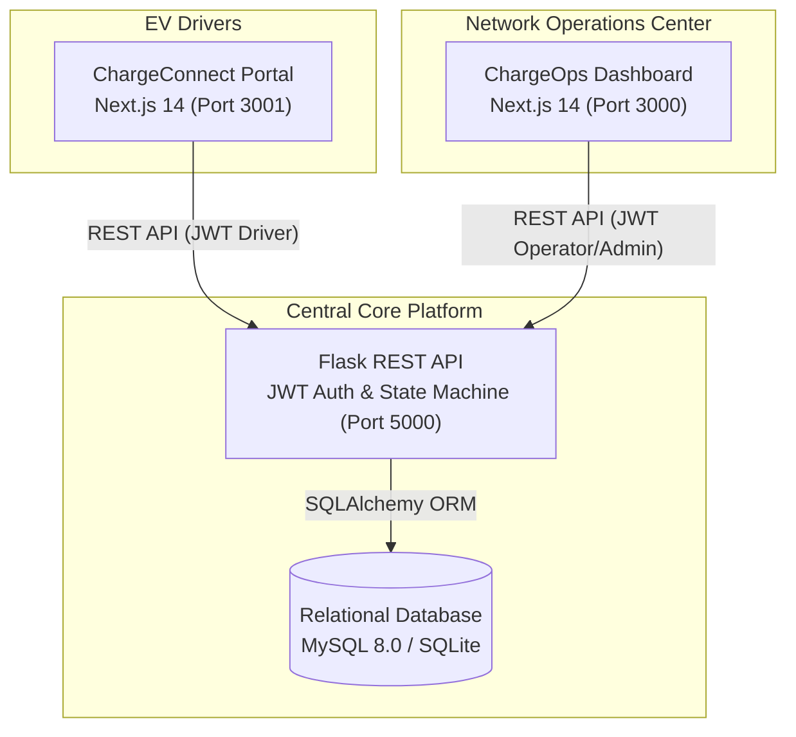

# Sonik EV Platform — Master Integration & QA Guide

Complete local development, quality assurance, and demonstration reference for the **Sonik EV Platform** (inspired by the domain and workflows of Sonik Mobility).

---

## 🏛️ System Architecture

The platform consists of three decoupled components operating against a shared central relational database:



---

## 🚀 Quick Startup Guide

### Port Allocations
- **Backend API:** `http://localhost:5000/api/v1`
- **ChargeOps (Operator):** `http://localhost:3000`
- **ChargeConnect (Driver):** `http://localhost:3001`

---

### Component 1: Flask REST API Backend
```powershell
# Navigate to backend directory
cd C:\Users\aariz\.gemini\antigravity\scratch\sonik-ev-platform

# Activate Python virtual environment
.\venv\Scripts\Activate.ps1

# (Optional) Seed / Reset Database
python database\seed_demo_data.py --force

# Start backend server
python app.py
```
> **Backend Health Check:** `http://localhost:5000/api/v1/health`

---

### Component 2: ChargeOps Operator Dashboard
```powershell
# Navigate to ChargeOps directory
cd C:\Users\aariz\.gemini\antigravity\scratch\sonik-chargeops

# Install dependencies (first time only)
npm install

# Start production server on port 3000
npm run start
# Or for development: npm run dev
```
> **ChargeOps URL:** `http://localhost:3000`

---

### Component 3: ChargeConnect Driver Portal
```powershell
# Navigate to ChargeConnect directory
cd C:\Users\aariz\.gemini\antigravity\scratch\sonik-chargeconnect

# Install dependencies (first time only)
npm install

# Start production server on port 3001
npm run start
# Or for development: npm run dev
```
> **ChargeConnect URL:** `http://localhost:3001`

---

## 👥 Demo Accounts & Credentials

| Role | Email | Password | Access Level |
| :--- | :--- | :--- | :--- |
| **ADMIN** | `admin@sonik.ev` | `admin123` | Full system access, all stations, chargers, sessions, analytics |
| **OPERATOR** | `operator@sonik.ev` | `operator123` | ChargeOps access, charger controls, ticket management, analytics |
| **DRIVER** | `driver@sonik.ev` | `driver123` | ChargeConnect portal, charger discovery, demo sessions, own history |
| **SUPPORT** | `support@sonik.ev` | `support123` | Ticket management, diagnostics, read-only analytics |

---

## 🗄️ Database Design & Scripts

The relational database enforces 7 distinct tables with strict foreign keys and constraints:
1. `users` — Primary driver/operator identities with bcrypt/scrypt password hashes and roles.
2. `stations` — Physical charging hub locations around Noida & Greater Noida.
3. `chargers` — Hardware dispensers (CCS2, Type 2, CHAdeMO) linked to stations (`CHECK (power_kw > 0)`).
4. `tariffs` — Time-bound commercial electricity pricing in INR per kWh.
5. `charging_sessions` — Core transactional ledger with state machine validation (`Created` &rarr; `Active` &rarr; `Completed`/`Cancelled`/`Failed`).
6. `service_tickets` — Incident management ledger for hardware/software issues.
7. `payment_records` — Mock payment reconciliation ledger for completed sessions.

### Database Setup Scripts
- **MySQL DDL Schema:** [`sonik-ev-platform/database/schema.sql`](file:///C:/Users/aariz/.gemini/antigravity/scratch/sonik-ev-platform/database/schema.sql)
- **MySQL Seed Data:** [`sonik-ev-platform/database/seed_demo_data.sql`](file:///C:/Users/aariz/.gemini/antigravity/scratch/sonik-ev-platform/database/seed_demo_data.sql)
- **Universal Python Seeder:** [`sonik-ev-platform/database/seed_demo_data.py`](file:///C:/Users/aariz/.gemini/antigravity/scratch/sonik-ev-platform/database/seed_demo_data.py)

---

## 🧪 Automated Testing & QA Execution

### 1. Unit Test Suite (34 Tests)
Runs in-memory tests against all routes, services, repositories, validators, and error handlers:
```powershell
cd C:\Users\aariz\.gemini\antigravity\scratch\sonik-ev-platform
.\venv\Scripts\python.exe -m unittest discover -s tests -v
```
**Result:** `Ran 34 tests in ~23s — OK`

### 2. End-to-End Integration Suite (TC01 – TC16)
Runs live HTTP calls against the active server verifying full-stack integration:
```powershell
cd C:\Users\aariz\.gemini\antigravity\scratch\sonik-ev-platform
.\venv\Scripts\python.exe tests\test_qa_integration.py
```
**Result:** `TOTAL TESTS RUN: 16 | PASSED: 16 | FAILED: 0`

---

## 📊 Test Case Results Matrix (TC01 – TC16)

| Test ID | Test Case Title | Target Endpoint | Expected Status | Verified Result |
| :--- | :--- | :--- | :--- | :--- |
| **TC01** | Successful login | `POST /auth/login` | `200 OK` | **PASS** (Issued Bearer token for Operator and Driver) |
| **TC02** | Invalid login | `POST /auth/login` | `401 Unauthorized` | **PASS** (Rejected incorrect password) |
| **TC03** | Load stations | `GET /stations` | `200 OK` | **PASS** (Retrieved 5 stations in Noida/Greater Noida) |
| **TC04** | Filter available chargers | `GET /chargers?status=Available` | `200 OK` | **PASS** (Returned only Available dispensers) |
| **TC05** | Reject negative power filter | `GET /chargers?min_power=-10` | `400 Bad Request` | **PASS** (Validation error: min_power must be positive) |
| **TC06** | Retrieve unknown charger | `GET /chargers/999999` | `404 Not Found` | **PASS** (Handled missing entity cleanly) |
| **TC07** | Create demo session | `POST /sessions` | `201 Created` | **PASS** (Generated session with initial status `Created`) |
| **TC08** | Reject session for unavailable charger | `POST /sessions` | `409 Conflict` | **PASS** (Rejected session initiation on Offline charger) |
| **TC09** | Activate valid session | `PATCH /sessions/<id>` | `200 OK` | **PASS** (Transitioned `Created` &rarr; `Active`, start time set) |
| **TC10** | Reject invalid session transition | `PATCH /sessions/<id>` | `422 Unprocessable` | **PASS** (Rejected illegal transition `Active` &rarr; `Created`) |
| **TC11** | Complete active session | `PATCH /sessions/<id>` | `200 OK` | **PASS** (Completed with 26.8 kWh, reset charger to Available) |
| **TC12** | Create service ticket | `POST /tickets` | `201 Created` | **PASS** (Logged ticket with status `Open`) |
| **TC13** | Update ticket status | `PATCH /tickets/<id>` | `200 OK` | **PASS** (Operator updated status to `InProgress` then `Resolved`) |
| **TC14** | Driver cannot access operator-only endpoint | `GET /analytics/summary` | `403 Forbidden` | **PASS** (Role guard strictly enforced) |
| **TC15** | Dashboard analytics update after session change | `GET /analytics/summary` | `200 OK` | **PASS** (Dynamic DB calculation of active sessions & energy) |
| **TC16** | Session created in ChargeConnect appears in ChargeOps | `GET /sessions` | `200 OK` | **PASS** (Cross-portal synchronization verified) |

---

## 🎓 Viva & Demonstration Guide

### 1. Architectural Concept
- **Decoupled Architecture:** Single source of truth (Flask REST API) preventing business logic duplication between driver and operator views.
- **Stateless Authentication:** Industry-standard JWT tokens with role claims (`ADMIN`, `OPERATOR`, `DRIVER`, `SUPPORT`).
- **Finite State Machine:** Charging session states follow strict directed acyclic graph:
  $$\text{Created} \rightarrow \text{Active} \rightarrow \text{Completed}$$
  $$\text{Created} \rightarrow \text{Cancelled}$$
  $$\text{Active} \rightarrow \text{Cancelled / Failed}$$

### 2. Live Demo Script
1. **Show Driver Experience on ChargeConnect (`http://localhost:3001`):**
   - Click "Autofill" for demo driver and sign in.
   - Filter chargers by location ("Greater Noida") and minimum power (50 kW+).
   - Select an available CCS2 100 kW charger at DLF Mall.
   - Click **Start Demo Session** &rarr; Observe state change to `Created`.
   - Click **Activate Session** &rarr; Observe real-time timer and adjust energy slider to 22.5 kWh.
   - Click **Finish & Disconnect** &rarr; Verify mock payment receipt in **My Sessions**.
2. **Show Operator Experience on ChargeOps (`http://localhost:3000`):**
   - Sign in as `operator@sonik.ev`.
   - View **Network Overview** &rarr; Verify the energy consumed and completed session immediately reflect in the metrics cards and charts.
   - Open **Session History** &rarr; Demonstrate that the session created by the driver on port 3001 is immediately visible to the operator on port 3000.
   - Open **Service Tickets** &rarr; Update a ticket status to `In Progress` or `Resolved`.

---

## 🔧 Troubleshooting Guide

| Issue | Root Cause | Solution |
| :--- | :--- | :--- |
| **Port 3000 or 3001 in use** | Another Node or Next.js process is active | Run `Get-Process node \| Stop-Process -Force` in PowerShell, then restart. |
| **Port 5000 in use** | Stray Python process holding the socket | Run `Get-Process python \| Stop-Process -Force` in PowerShell, then restart `python app.py`. |
| **CORS Error in Browser Console** | Frontend origin not present in backend whitelist | Ensure `CORS_ORIGINS` in `sonik-ev-platform/.env` includes `http://localhost:3000,http://localhost:3001`. |
| **Database Lock / SQLite Busy** | Concurrent file access or unclosed transaction | Run `python database/seed_demo_data.py --force` to reset the database file. |
| **Token Expired Error (401)** | JWT expired after validity period (1 hour) | Click "Sign In" again; the frontend client will acquire a fresh token. |
| **Next.js Prerender Error on `useSearchParams`** | Missing React Suspense boundary during static export | Ensure dynamic hooks like `useSearchParams()` are wrapped in `<Suspense fallback={...}>` (already applied in both frontends). |
